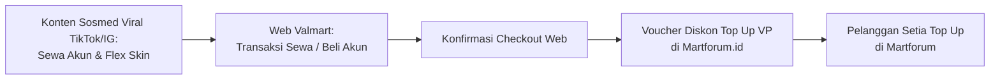

# Actionable Insight & Rencana Implementasi
**Target Brand**: Valmart (`valmart.id`) & Martforum (`martforum.id`)  
**Basis Data**: Hasil Scraping Kompetitor (Valforum, Valskuy/Skuyrent, Fuze Valo, Johen, Xylious, Tokovalorant, ZYS, SkinKitchen, Itemku)  
**Terakhir Diperbarui**: 1 November 2026  
**Tujuan**: Implementasi langsung pada strategi konten harian, kampanye November 2026, dan funnel penjualan terintegrasi.

---

## I. Insight & Strategi untuk VALMART (`valmart.id`)

### 1. Jadikan Fitur "Sewa Akun" Sebagai Pintu Masuk Konten TikTok & Reels
* **Realita Lapangan**: Beli akun Valorant butuh Rp 300rb – Rp 3jt+ (barrier beli tinggi, pertimbangan lama). Tapi **Sewa Akun** cuma butuh Rp 10rb – Rp 25rb (pembelian impulsif tanpa ragu).
* **Formula Kompetitor**: Valskuy (`@skuy.rent`) sukses besar di TikTok karena mengangkat rasa *FOMO* anak muda yang mau mabar weekend pakai skin sultan tanpa boncos.
* **Implementasi Valmart**:
  * Konten TikTok format POV: *"POV: Lu mabar weekend cuma modal 15 ribu sewa akun di Valmart, temen satu lobi ngira lu sultan beneran."*
  * Tampilkan sensasi efek finisher skin langka (Kuronami, Reaver, Champions, Arcane) dengan CTA: *"Gak perlu beli jutaan, sewa langsung di valmart.id mulai 10 ribuan."*
  * **Fungsi**: Sewa adalah pintu masuk termudah untuk mendapatkan pelanggan baru yang nantinya akan naik kelas menjadi pembeli akun atau pelanggan top-up Martforum.

---

### 2. Adopsi Taktik "TikTok Live Demo Finisher" (Pelajaran dari Tokovalorant)
* **Realita Lapangan**: Tokovalorant membuktikan bahwa live streaming push rank sambil mencoba skin yang ready menghasilkan konversi rental instan tertinggi.
* **Implementasi Valmart**:
  * Helmy / talent Valmart menjadwalkan sesi **Live Streaming TikTok di jam weekend** (Jumat/Sabtu malam).
  * Main di mode Unrated / Swiftplay menggunakan akun rental sultan yang statusnya ready.
  * Buat interaksi live: penonton minta dites finisher senjata tertentu, host langsung mainkan, lalu host menyematkan link pemesanan rental di kolom komentar/bio.

---

### 3. Bangun "Authority & Trust" Lewat Edukasi Anti-HB (Hackback)
* **Realita Lapangan**: Ketakutan terbesar nomor 1 pembeli akun game di Indonesia adalah **Hackback (HB)** (akun ditarik kembali oleh pemilik pertama via support tiket Riot). Banyak drama akun suntikan tanpa FMail di grup FJB FB.
* **Implementasi Valmart**:
  * Buat serial konten edukasi di Reels & TikTok: *"Cara bedain akun First Mail (FMail) asli vs Akun Suntikan"* dan *"Kenapa beli akun sembarangan di FB rawan di-HB?"*.
  * Tampilkan proses verifikasi ketat Valmart saat kurasi akun masuk (transparansi data).
  * Tonjolkan USP resmi: **Garansi Uang Kembali 100% Anti-HB**. Ini memposisikan Valmart jauh lebih aman daripada penjual anonim di medsos.

---

### 4. Dorong Kampanye "Cashout Instant 15 Menit" untuk Pasokan Stok Akun
* **Realita Lapangan**: Bisnis JB akun sering menghadapi kendala kehabisan stok akun sultan berkualitas.
* **Implementasi Valmart**:
  * Manfaatkan fitur Cashout di website `valmart.id`.
  * Rilis konten rutin untuk pemain yang mau pensiun: *"Pensiun main Valorant tapi skin numpuk? Cashout akunmu di Valmart, 15 menit langsung cair ke e-wallet/rekening tanpa kena tipu middleman palsu."*
  * Mendatangkan suplai inventaris akun berharga wajar secara konsisten.

---

## II. Insight & Strategi untuk MARTFORUM (`martforum.id`)

### 1. Menangkan Persaingan di "Kecepatan QRIS 1-3 Detik & Akses 24 Jam Tanpa Admin"
* **Realita Lapangan**: Web top-up di Indonesia sangat banyak. Bersaing margin receh Rp 500 dengan bot reseller besar tidak efektif jangka panjang.
* **Implementasi Martforum**:
  * Posisikan Martforum sebagai platform top up otomatis paling ramah anak mabar: **Bayar via QRIS detik itu juga langsung masuk**, tanpa perlu antre nunggu admin WA bangun di jam 2 pagi.
  * Konten komparasi Jonathan: *"Momen ngenes toko sebelah: top up jam 1 malem, dibalas jam 9 pagi pas skin incaran udah hilang dari Daily Shop."* vs *"Martforum: Scan QRIS pas countdown agent select, VP udah mendarat sebelum ronde 1 mulai."*

---

### 2. Edukasi "Legalitas 100% Anti-Minus & Anti-Ban Riot"
* **Realita Lapangan**: Marak kasus top-up ilegal via carding/refund yang menyebabkan saldo VP minus dan akun terkena ban permanen Riot.
* **Implementasi Martforum**:
  * Konten investigasi VO Jonathan: Menjelaskan bahaya top up VP murah tidak masuk akal yang berujung Riot ban.
  * Tegaskan bahwa Martforum hanya menggunakan jalur resmi distributor legal, menjamin saldo 100% aman dan anti-minus seumur hidup.

---

## III. Sinergi Cross-Selling Antara Valmart & Martforum

Sebagai Marketing Coordinator yang memegang kedua brand ini sekaligus, kita memiliki ekosistem tertutup (*closed-loop funnel*):

1. **Voucher Sinergi Pasca-Transaksi**:
   * Setiap customer yang menyewa atau membeli akun di **Valmart**, otomatis menerima voucher potongan harga top-up di **Martforum.id**.
2. **Pemanfaatan Campaign Streamer November**:
   * Streamer partner di ajang **Affiliate Sprint** didorong mempromosikan kedua brand: transaksi sewa Kode C+ (Valmart) dan transaksi top-up >Rp 150k (Martforum) sama-sama dihitung sebagai poin klasemen resmi.
3. **Penyatuan Voice & Cross-Support**:
   * Tim CS Valmart langsung merekomendasikan link Martforum saat customer bertanya: *"Kak, bisa sekalian top up VP gak buat beli skin baru?"*.
