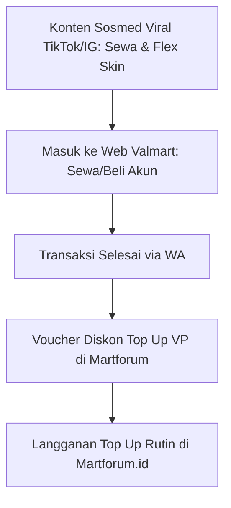

# Actionable Insight & Rencana Implementasi
**Target Brand**: Valmart (`valmart.id`) & Martforum (`martforum.id`)  
**Basis Data**: Hasil Scraping 7 Kompetitor (Valforum, Valskuy, Fuze Valo, Johen, Xylious, Tokovalorant, ZYS)  
**Tujuan**: Implementasi langsung pada strategi digital marketing, konten sosmed, dan funnel penjualan.

---

## I. Insight & Strategi untuk VALMART (`valmart.id`)

### 1. Jadikan Fitur "Sewa Akun" Sebagai Ujung Tombak Konten TikTok (Hook Terkuat)
* **Realita Lapangan**: Beli akun Valorant butuh Rp 300rb – Rp 3jt+ (barrier beli tinggi, mikir lama). Tapi **Sewa Akun** cuma butuh Rp 10rb – Rp 25rb (impulsif, tanpa mikir).
* **Formula Kompetitor**: Valskuy (`@skuy.rent`) sukses besar di TikTok karena mengangkat rasa *FOMO* anak muda yang mau mabar weekend pakai skin mahal.
* **Implementasi Valmart**:
  * Bikin konten TikTok format POV: *"POV: Lu mabar weekend cuma modal 15 ribu sewa akun di Valmart, temen satu lobi ngira lu sultan beneran."*
  * Tampilkan sensasi efek finisher skin langka (Kuronami, Reaver, Champions) dengan CTA: *"Gak perlu beli jutaan, tinggal sewa di valmart.id mulai 10 ribuan."*
  * **Fungsi**: Sewa adalah pintu masuk termudah untuk mendapatkan pelanggan baru yang nantinya akan naik kelas menjadi pembeli akun atau pelanggan top-up Martforum.

---

### 2. Pisahkan Alur "Akun Traffic (Medsos)" vs "Katalog Transaksi (Web)"
* **Realita Lapangan**: Jual beli akun game melanggar Terms of Service (ToS) Riot Games dan rawan di-report di platform Meta (IG) & TikTok.
* **Pola Valforum & Valskuy**: Mereka tidak pernah memposting katalog akun jualan di feed akun utama. Akun utama 100% konten media/meme/informasi, sedangkan transaksi diarahkan ke website dan link bio.
* **Implementasi Valmart**:
  * Akun `@valmart.id` (TikTok) dan `@valomart._id` (IG) fokus sebagai **magnet audiens**: Konten tips aim, meme Valorant, drama sewa akun, dan klip finisher.
  * Jangan penuhi feed IG dengan screenshot akun dan harga mentah. Arahkan semua traffic masuk ke **katalog interaktif `valmart.id`** yang sudah memiliki sistem filter canggih (filter rank, tier harga, skin).

---

### 3. Bangun "Authority & Trust" Lewat Edukasi Anti-HB (Hackback)
* **Realita Lapangan**: Ketakutan terbesar nomor 1 pembeli akun game di Indonesia adalah **Hackback (HB)** (akun ditarik kembali oleh pemilik pertama). Johen Store menang karena reputasi keamanan.
* **Implementasi Valmart**:
  * Buat serial konten edukasi di Reels & TikTok: *"Cara bedain akun First Mail (FMail) vs Akun Suntikan"* atau *"Kenapa beli akun sembarangan di FB rawan di-HB?"*.
  * Tampilkan proses verifikasi Valmart saat menerima akun (transparansi kurasi).
  * Ini otomatis memposisikan Valmart sebagai platform profesional & aman, membedakannya dari penjual receh/ilegal di grup FB.

---

### 4. Genjot Kampanye "Cashout Instant" untuk Pasokan Stok Akun
* **Realita Lapangan**: Bisnis JB akun sering macet di pasokan stok (stok akun bagus sering habis).
* **Implementasi Valmart**:
  * Valmart sudah punya halaman Cashout di website.
  * Buat kampanye konten untuk pemain yang ingin pensiun: *"Pensiun main Valorant tapi skin numpuk? Cashout akunmu di Valmart, 15 menit langsung cair ke rekening/e-wallet."*
  * Ini cara otomatis mendatangkan inventaris akun dengan harga masuk akal tanpa harus berburu manual.

---

## II. Insight & Strategi untuk MARTFORUM (`martforum.id`)

### 1. Hindari Perang Harga Mentah, Menangkan di "Kecepatan & Sinergi"
* **Realita Lapangan**: Web top-up di Indonesia sangat banyak. Bersaing margin 500 perak dengan bot reseller besar tidak akan berkelanjutan.
* **Implementasi Martforum**:
  * Promosikan keunggulan **Otomatis QRIS & Transaksi Detik**: Highlight kemudahan bayar tanpa ribet login.
  * Buat konten video perbandingan: *"Top up pas lagi di lobby match, belum kelar countdown VP udah masuk."*

---

### 2. Terapkan Model "Mini Tournament / Community Scrim" (Tiru Tokovalorant & Valforum)
* **Realita Lapangan**: Tokovalorant dan Valforum mendapatkan puluhan ribu follower loyal karena rajin membuat wadah kompetisi gamer.
* **Implementasi Martforum**:
  * Adakan turnamen mini mingguan/bulanan (misal: *Martforum 3v3 One-Agent Cup* atau turnamen MLBB/Valorant antarkomunitas) dengan hadiah saldo / VP.
  * Live-kan di TikTok.
  * Syarat daftar: Menggunakan ID Martforum / belanja minimal 1x di Martforum. Ini strategi paling murah untuk mengakuisisi ribuan database gamer aktif.

---

## III. Sinergi Cross-Selling Antara Valmart & Martforum (Kunci Peran Coordinator)

Sebagai Marketing Coordinator yang memegang kedua brand ini sekaligus, Anda punya keuntungan yang tidak dimiliki kompetitor tunggal:

1. **Voucher Sinergi**:
   * Setiap customer yang membeli atau menyewa akun di **Valmart**, berikan kupon/link khusus: *"Klaim diskon top-up VP perdana di Martforum.id"*.
2. **Paket Bundling**:
   * Sewa akun + Top Up Battlepass di Martforum dengan harga bundling.
3. **Penyatuan Voice & CS Response**:
   * Admin WhatsApp Valmart dapat merekomendasikan Martforum jika buyer bertanya: *"Admin, bisa sekalian isi VP gak?"* $\rightarrow$ Langsung lempar link Martforum.
