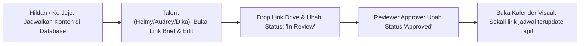

# ⚡ Valmart & Martforum Creative Tracker (Lean & High-Aesthetic)
**Sistem**: Google Sheets + Google Apps Script (Sheet-as-a-SaaS)  
**Tujuan**: Tracker terpadu konten harian tim kreatif (Helmy, Audrey, Dika, Hildan, Ko Jeremy) dengan **tampilan kalender visual modern** tanpa over-engineering.

---

## 🎨 Mengapa Tracker Ini Dibuat Lean & Cantik?

Banyak tracker tim konten mangkrak karena terlalu rumit (kolom kebanyakan) dan desainnya kaku seperti Excel 1990-an. Sistem ini dirancang dengan prinsip:
1. **Visual Kalender Modern (Bukan Sekadar Baris Tabel)**: Tampilan grid kalender bulanan (Senin–Minggu) dengan kartu konten berjarak lega, status warna lembut (pastel modern), dan pin penanda otomatis **📍 HARI INI**.
2. **Lean & Minim Beban Input**: Editor hanya perlu memilih Tanggal, Brand, PIC, judul singkat, drop link preview, dan pilih Status.
3. **No Bloatware**: Tanpa bot WhatsApp bayar langganan yang ribet, tanpa sinkronisasi Google Calendar yang rawan error auth. Semua data dan tampilan hidup di dalam 1 Google Spreadsheet yang ringan.

---

## 📐 Arsitektur Spreadsheet (Hanya 2 Tab)

```
┌────────────────────────────────────────────────────────┐
│              SISTEM TRACKER KREATIF LEAN               │
├──────────────────────────┬─────────────────────────────┤
│ TAB 1: 📅 KALENDER VISUAL │ TAB 2: 📝 DATABASE KONTEN   │
│ (Grid Kalender Otomatis) │ (Tabel Input 7 Kolom Utama) │
└──────────────────────────┴─────────────────────────────┘
```

### 1. Tab `📅 Kalender Visual`
* **Selector Bulan & Tahun**: Cukup ketik angka bulan (1–12) di sel `C2` dan tahun di sel `E2`, lalu klik **Render / Refresh Kalender**.
* **Kotak Tanggal**:
  * Header tanggal abu-abu slate bersih (atau ungu menyala jika bertepatan dengan **📍 HARI INI**).
  * Kartu konten berisi: `[VAL]` atau `[MART]`, nama PIC, judul hook, dan status badge warna (`🟢 Approved`, `🟡 In Progress`, dll).

### 2. Tab `📝 Database Konten`
* Tabel modern dengan dropdown otomatis:
  * **Brand**: `Valmart` / `Martforum`
  * **PIC**: `Helmy (Video)`, `Audrey (VO)`, `Dika (Editor/Desain)`
  * **Status**: `⚪ Draft`, `🟡 In Progress`, `🟠 In Review`, `🔴 Revision`, `🟢 Approved`, `🟣 Published`

---

## 🚀 Panduan Setup Cepat (Kurang dari 2 Menit)

1. Buka [Google Sheets](https://sheets.new) baru di browser Anda. Beri judul misal: **`Valmart & Martforum — Creative Tracker 2026`**.
2. Di menu atas Google Sheets, klik **Extensions (Ekstensi)** $\rightarrow$ **Apps Script**.
3. Hapus semua teks yang ada di editor Apps Script, lalu copy-paste seluruh isi file [Code.gs](file:///d:/ANTIGRAVITY/Hildan/All%20Projects/Ko%20Jeremy/07%20Internal%20Tools/Creative%20Tracker/apps_script/Code.gs).
4. Klik tombol **Save (Ikon Disket)** atau tekan `Ctrl + S`.
5. Di dropdown fungsi bagian atas editor, pilih fungsi **`setupTracker`**, lalu klik tombol **Run (Jalankan)**.
   *(Saat pertama kali dijalankan, Google akan meminta izin otorisasi standar akun Google Anda. Klik Review Permissions $\rightarrow$ pilih akun $\rightarrow$ Advanced $\rightarrow$ Go to Untitled (unsafe) $\rightarrow$ Allow)*.
6. Kembali ke tab Google Sheet Anda:
   * Tab **`📅 Kalender Visual`** dan **`📝 Database Konten`** sudah terbuat rapi secara otomatis!
   * Menu custom **`⚡ Valmart & Martforum`** akan muncul di toolbar atas.
7. Klik menu **`⚡ Valmart & Martforum`** $\rightarrow$ **`🌱 Muat Jadwal Aktif November 2026`** untuk langsung mengimpor seluruh naskah dan jadwal Week 3 & Week 4 November 2026 yang aktif saat ini.

---

## 💡 Alur Kerja Harian Tim (Workflow)



1. **Jadwalkan**: Masukkan tanggal, nama PIC, topik, dan link brief di tab `📝 Database Konten`.
2. **Produksi**: Helmy / Audrey / Dika mengerjakan konten. Saat selesai edit, masukkan link preview (Google Drive / CapCut) di kolom link dan ubah status ke `🟠 In Review`.
3. **Approval**: Reviewer mengecek draft. Jika sudah aman, ganti status ke `🟢 Approved`.
4. **Pantau Jadwal**: Klik menu **`[⚡ Valmart & Martforum] -> [📅 Render / Refresh Kalender Visual]`** kapan saja untuk melihat update terkini dalam format kalender visual.
