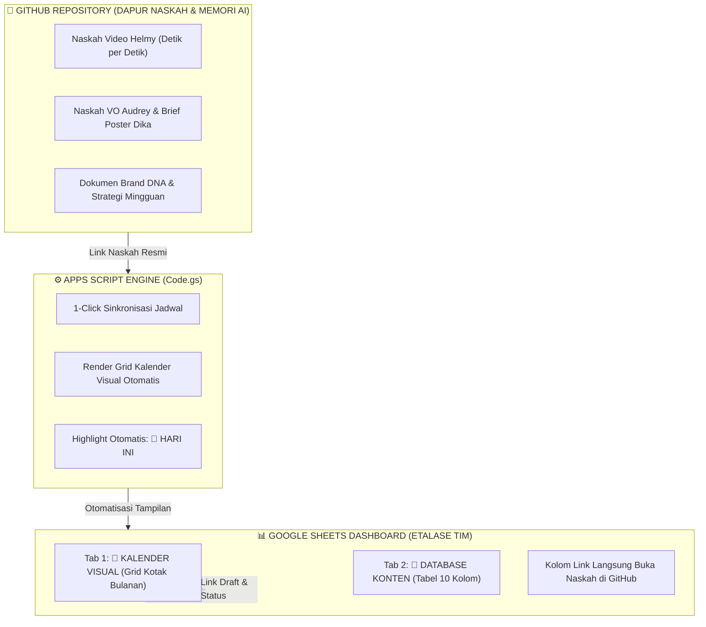

# ⚡ Valmart & Martforum Creative Engine & Tracker
**Integrasi**: GitHub Repository (Dapur/Naskah) $\longleftrightarrow$ Google Sheets (Dashboard/Kalender)  
**Dikembangkan untuk**: Tim Digital Marketing & Kreatif Valmart.id & Martforum.id (Ko Jeremy, Hildan, Helmy, Audrey, Dika).

---

## 🏗️ Blueprint Arsitektur Sistem

Sistem ini memisahkan secara tegas antara **tempat berpikir & naskah detail (GitHub)** dengan **tempat memantau deadline & status (Google Sheets)**:

---

## 🎨 Keunggulan Desain Visual (Anti-Kaku)

1. **Kalender Visual Grid (Bukan Sekadar Baris Excel)**:
   * Menampilkan kalender bulanan 7 kolom (Senin s/d Minggu).
   * Kotak tanggal hari ini otomatis di-highlight dengan latar ungu lembut dan lencana **`📍 HARI INI`**.
   * Di dalam kotak tanggal, muncul kartu konten ringkas:
     * Tag Brand: `[VAL]` (Valmart) atau `[MART]` (Martforum)
     * Nama Talent/PIC: `Helmy`, `Audrey`, atau `Dika`
     * Topik / Hook: Judul konten singkat
     * Status Badge: `🟢 Approved`, `🟡 In Progress`, `🟠 In Review`, `🟣 Published`
2. **Koneksi Langsung ke Naskah GitHub**:
   * Di tab `📝 Database Konten`, ada kolom **`📖 Link Naskah (GitHub)`**.
   * Helmy, Audrey, atau Dika cukup klik link tersebut untuk langsung membaca naskah rekaman detik per detik, sound effect, dan draf caption di browser/HP mereka!
3. **Editor Drop Link Praktis**:
   * Editor hanya perlu memasukkan link preview video/desain (Google Drive / CapCut) di kolom **`🎬 Link Draft Preview`** dan mengganti status ke `🟠 In Review`.

---

## 🚀 Panduan Pasang & Jalankan (Kurang dari 2 Menit)

1. Buka spreadsheet baru di [sheets.new](https://sheets.new). Beri nama misal: **`Valmart & Martforum — Content Engine 2026`**.
2. Klik menu **Extensions (Ekstensi)** $\rightarrow$ **Apps Script**.
3. Hapus kode bawaan, lalu copy-paste seluruh isi file [Code.gs](file:///d:/ANTIGRAVITY/Hildan/All%20Projects/Ko%20Jeremy/07%20Internal%20Tools/Creative%20Tracker/apps_script/Code.gs).
4. Tekan **Save (`Ctrl + S`)**.
5. Di bagian atas editor, pilih fungsi **`setupTracker`**, lalu klik tombol **Run**.
   *(Beri izin otorisasi standar Google saat pertama kali muncul prompt keamanan)*.
6. Kembali ke tab Google Sheets:
   * Format kedua tab (`📅 Kalender Visual` & `📝 Database Konten`) otomatis selesai ditata rapi.
   * Muncul menu baru di toolbar: **`⚡ Valmart & Martforum`**.
7. Klik **`⚡ Valmart & Martforum`** $\rightarrow$ **`📥 Sinkronisasi Naskah dari GitHub`**:
   * Seluruh 18 baris jadwal aktif (Week 3 & Week 4 November 2026) langsung terisi lengkap dengan link naskah GitHub, dan kalender visual otomatis menampilkan jadwal bulan berjalan!

---

## 🔄 Cara Kerja Kolaborasi Harian (Hildan & AI)

1. **Rencana Baru**: Hildan minta ke AI: *"Buatin jadwal dan naskah Week 1 Desember dong"*.
2. **AI Eksekusi**: AI menyusun naskah detail di folder GitHub, mengupdate matriks di `Code.gs`, lalu melakukan commit & push.
3. **Hildan QC & Sync**: Hildan cukup buka Google Sheets, klik menu **`⚡ Valmart & Martforum`** $\rightarrow$ **`📥 Sinkronisasi Naskah dari GitHub`**. Selesai dalam 5 detik!
